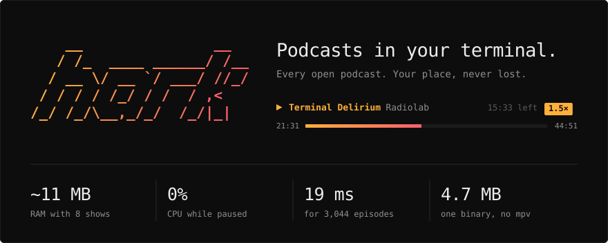
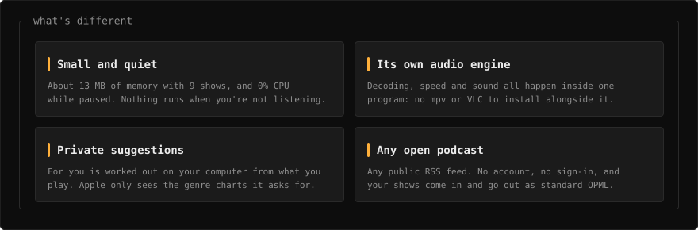
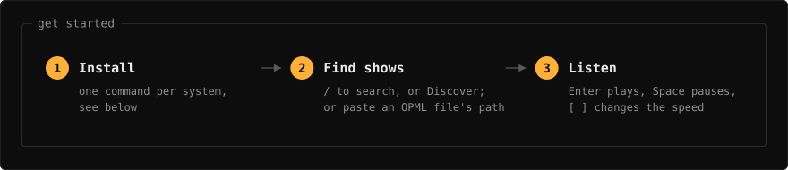
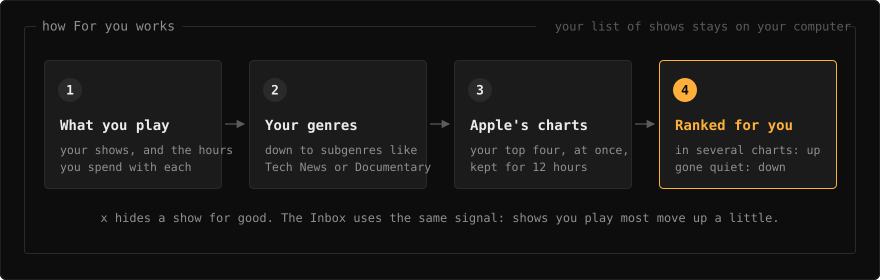
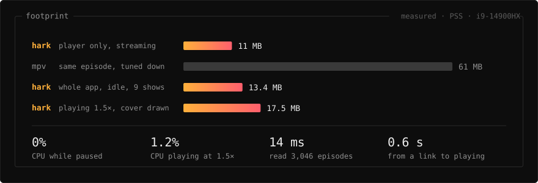
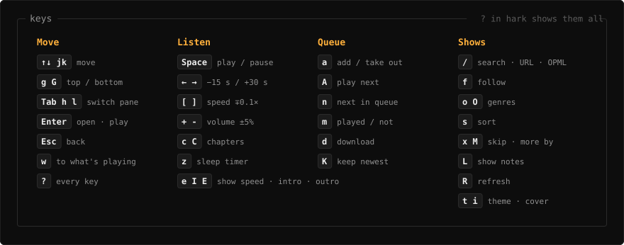
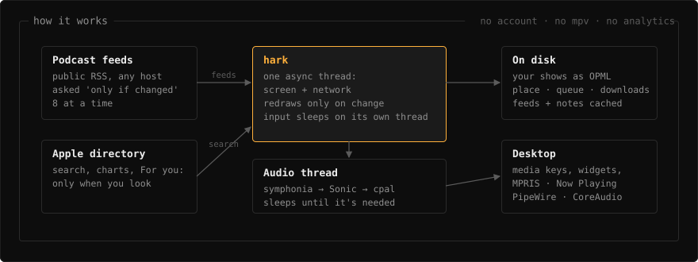

<p align="center">
  
</p>

<p align="center">
  <a href="https://github.com/junaydirfan/hark/releases/latest"></a>
  
  
  
  
  
</p>

<p align="center">
  
</p>

<p align="center">
  <a href="#install"><strong>Install</strong></a> &nbsp;·&nbsp;
  <a href="#features"><strong>Features</strong></a> &nbsp;·&nbsp;
  <a href="#for-you"><strong>For you</strong></a> &nbsp;·&nbsp;
  <a href="#numbers"><strong>Numbers</strong></a> &nbsp;·&nbsp;
  <a href="#keys"><strong>Keys</strong></a> &nbsp;·&nbsp;
  <a href="#faq"><strong>FAQ</strong></a>
</p>

hark is a podcast player for the terminal. It plays any podcast with a public feed, which is most of them, straight from wherever the show is hosted. It has its own audio engine and keeps its footprint small. Its look comes from [trill](https://github.com/junaydirfan/trill), a terminal Spotify player.

<p align="center">
  
</p>

## Install

<p align="center">
  
</p>

**Linux** (x86_64; Ubuntu 24.04+, Debian 13+, Fedora 40+, Arch, CachyOS):

```sh
curl -L https://github.com/junaydirfan/hark/releases/latest/download/hark-linux-x86_64.tar.gz | tar xz
mkdir -p ~/.local/bin && mv hark ~/.local/bin/
```

**macOS** (Apple Silicon):

```sh
curl -L https://github.com/junaydirfan/hark/releases/latest/download/hark-macos-arm64.tar.gz | tar xz
sudo mkdir -p /usr/local/bin && sudo mv hark /usr/local/bin/
```

**Windows** (10 and 11, in PowerShell):

```powershell
$dir = "$env:LOCALAPPDATA\Programs\hark"
Invoke-WebRequest https://github.com/junaydirfan/hark/releases/latest/download/hark-windows-x86_64.zip -OutFile "$env:TEMP\hark.zip"
Expand-Archive "$env:TEMP\hark.zip" -DestinationPath $dir -Force
[Environment]::SetEnvironmentVariable("Path", [Environment]::GetEnvironmentVariable("Path", "User") + ";$dir", "User")
```

Then open a new terminal and run **`hark`**. To update later, run **`hark --update`**.

<details>
<summary><strong>If something doesn't work</strong></summary>

- **`hark: command not found` (Linux):** `~/.local/bin` isn't on your `PATH`. Run `fish_add_path ~/.local/bin` (fish), or add `export PATH="$HOME/.local/bin:$PATH"` to `~/.bashrc` or `~/.zshrc`, then open a new terminal.
- **macOS says it "can't be opened":** that happens when it was downloaded in a browser. Run `xattr -d com.apple.quarantine /usr/local/bin/hark` once.
- **Windows says "Windows protected your PC":** choose **More info → Run anyway**, or run `Unblock-File "$env:LOCALAPPDATA\Programs\hark\hark.exe"` once.
- **No sound on Linux:** hark plays through PipeWire or PulseAudio, which every desktop has.
- **Media keys go to another app (macOS):** play something in hark once; macOS sends the keys to whatever played last.
- **`hark --update` asks for a password:** it does when hark is in a folder only an admin can change, like `/usr/local/bin`.

hark is developed on Linux. The macOS and Windows builds are built and tested by CI on every release but have had less everyday use, so please [open an issue](https://github.com/junaydirfan/hark/issues) if something seems off.
</details>

<details>
<summary><strong>Build from source, or remove hark</strong></summary>

**Build:** you need [Rust](https://rustup.rs) 1.88 or newer, and on Linux the ALSA and OpenSSL headers (`sudo pacman -S alsa-lib openssl`, `sudo apt install libasound2-dev libssl-dev pkg-config`, or `sudo dnf install alsa-lib-devel openssl-devel`).

```sh
git clone https://github.com/junaydirfan/hark && cd hark
cargo install --path .
```

**Remove:** delete the program and its two folders.

| | Program | Your shows and progress | Caches |
|---|---|---|---|
| Linux | `~/.local/bin/hark` | `~/.local/share/hark` | `~/.cache/hark` |
| macOS | `/usr/local/bin/hark` | `~/Library/Application Support/hark` | `~/Library/Caches/hark` |
| Windows | `%LOCALAPPDATA%\Programs\hark` | `%APPDATA%\hark` | `%LOCALAPPDATA%\hark` |
</details>

## Features

<p align="center">
  
</p>

<details>
<summary><strong>Every feature in a line</strong></summary>

- **Search** (`/`) the Apple Podcasts directory, or paste a feed URL or an OPML file's path.
- **Discover** (`o` / `O` for genres) shows the charts for your country, with **For you** at the top.
- **Preview, then follow** (`f`): play any show's episodes before you follow it.
- **Inbox** (new episodes from the last 30 days) and **In progress** (what you started).
- **Picks up where you left off**, with a short rewind when you've been away.
- **Speed** from 0.5× to 3× with the pitch kept ([Sonic](https://github.com/waywardgeek/sonic)). `e` gives a show its own speed.
- **Queue** (`a`, `A` to play next). It carries on when an episode ends.
- **Chapters** (`c` / `C`) from the show's chapters file or the MP3 itself.
- **Downloads** (`d`) for offline listening. `K` keeps a show's newest episodes downloaded, and played ones are removed.
- **Sleep timer** (`z`): 15 to 60 minutes or the end of the episode, with a short fade.
- **Skip intros and outros** (`I` / `E`), set once per show.
- **Sort a show** (`s`): newest, oldest, longest or shortest first, remembered per show.
- **Show notes** (`L`) as clean text, with the links listed.
- **Cover art**: real images in kitty, Ghostty, WezTerm, foot, iTerm2 and Konsole, colour blocks elsewhere.
- **Media keys** and desktop widgets: MPRIS on Linux, Now Playing on macOS.
- **MP3 and M4A/AAC** episodes.
- **Stays up to date**: feeds refresh at launch, every hour while hark is open, and on `R`.
- **Your shows are yours**: `hark --export > shows.opml` takes them to any other app.
- **trill's look**: colour themes (`t`), the mouse, and `?` for every key.
</details>

<p align="center">
  
</p>

## For you

<p align="center">
  
</p>

<p align="center">
  
</p>

The Genre column shows why each show was picked. Press `x` to hide a suggestion, or `M` to see more from the same maker.

<p align="center">
  
</p>

## Numbers

<p align="center">
  
</p>

<details>
<summary><strong>All measurements</strong></summary>

Measured on an i9-14900HX, memory as PSS, release build 0.1.9.

| | |
|---|---|
| Idle, 9 shows (7,937 episodes) | 13.4 MB |
| Idle, 15 shows (16,900 episodes) | 16.6 MB from cache, 24.5 MB right after refreshing every feed |
| Playing at 1.5×, cover drawn | 17.5 MB |
| The player on its own, streaming | ~11 MB |
| mpv playing the same episode, trimmed down (measured once, earlier) | 61 MB |
| CPU while paused or idle | 0 (no thread wakes up) |
| CPU while playing at 1.5×, screen included | ~1.2% of one core |
| Read a 20.7 MB feed (3,046 episodes) | 14 ms |
| Read a 2.2 MB feed (355 episodes) | 4 ms |
| First frame, from the disk cache | ~26 ms |
| From a link to playing | ~0.6 s |
| Refresh a feed that hasn't changed | no body downloaded (HTTP 304) |
| The program | 5.5 MB, nothing else to install |
</details>

## Keys

<p align="center">
  
</p>

<details>
<summary><strong>Keys as text</strong></summary>

| Key | Action | | Key | Action |
|---|---|---|---|---|
| `↑↓` `jk` `g` `G` | move | | `Space` | play / pause |
| `Tab` `h` `l` | switch pane | | `←` `→` | back 15 s / forward 30 s |
| `Enter` | open / play | | `[` `]` | speed −/+ 0.1× |
| `Esc` | back | | `+` `-` | volume |
| `w` | go to what's playing | | `c` `C` | next chapter / back |
| `/` | search, feed URL or OPML | | `z` | sleep timer |
| `f` | follow | | `e` | this show keeps its own speed |
| `o` `O` | Discover genres | | `I` `E` | skip this show's intro / outro |
| `s` | sort a show | | `a` `A` | queue / play next |
| `x` | hide from For you | | `n` | next in the queue |
| `M` | more from this maker | | `m` | mark played / unplayed |
| `L` | show notes | | `d` | download / delete download |
| `R` | refresh now | | `K` | keep a show's newest downloaded |
| `D` `D` | unfollow | | `t` `i` | colour theme / cover on-off |
| `?` | every key | | `q` | quit |

In lists: `▶` playing, `◔ ◑ ◕` started, `✓` played, `≡` queued, `⤓` downloaded.
</details>

## How it works

<p align="center">
  
</p>

<details>
<summary><strong>Why it stays light</strong></summary>

- One thread draws the screen and does the networking; input and audio each sleep on their own thread until they're needed. The screen redraws only when something changes.
- Audio is decoded inside hark ([symphonia](https://github.com/pdeljanov/Symphonia)), sped up by [Sonic](https://github.com/waywardgeek/sonic) and played through [cpal](https://github.com/RustAudio/cpal). Pausing closes the audio output, so nothing runs while paused.
- Episodes play while they download. Seeking ahead restarts the download from there.
- Feeds are read in a single pass and refreshed only if they've changed.
- Each episode takes 64 bytes in memory. Show notes, chapters and transcript links stay on disk and are read when you open them.
- Only the rows on screen are drawn, so a 3,000-episode show scrolls as quickly as a short one.
</details>

## Privacy

hark has no account and no analytics. It connects to:

- **the servers of the shows you follow**, for their feeds and audio;
- **Apple's public podcast directory**, only for search, charts and For you. For you asks for genre charts; your list of shows isn't sent;
- **GitHub**, once a day, to check for a new version.

<details>
<summary><strong>Where hark keeps things</strong></summary>

| | |
|---|---|
| `~/.local/share/hark/subscriptions.opml` | your shows, as standard OPML |
| `~/.local/share/hark/state.tsv` | your place in each episode, and what you've finished |
| `~/.local/share/hark/queue.tsv` | the queue |
| `~/.local/share/hark/show-prefs.tsv` | per-show sort, speed, intro/outro skip and downloads |
| `~/.local/share/hark/downloads/` | downloaded episodes |
| `~/.local/share/hark/not-interested.txt` | shows hidden from For you (delete a line to undo) |
| `~/.local/share/hark/prefs` | speed, volume, theme, cover |
| `~/.cache/hark/` | feeds, show notes and charts; safe to delete |

On macOS these are under `~/Library/Application Support/hark` and `~/Library/Caches/hark`; on Windows under `%APPDATA%\hark` and `%LOCALAPPDATA%\hark`.
</details>

## FAQ

**Can it play Spotify podcasts?**
Not Spotify exclusives: Spotify doesn't make them available to other players. Most shows on Spotify also have a public feed, though; search for them in hark.

**Can I bring my shows from another app?**
Yes. Export an OPML file from your old app (AntennaPod, Pocket Casts, Overcast, Apple Podcasts and others can), press `/` in hark, and paste the file's path.

**Does my place sync with my phone?**
Not yet. Sync through gPodder (gpodder.net or Nextcloud, which AntennaPod supports) is planned; see the [plan](PLAN.md).

**Video podcasts?**
hark plays their audio.

**Why not use mpv?**
mpv is a great player. hark has its own small engine so it can stay open all day using little memory; in one test, mpv used about 61 MB for an episode that hark's player plays in about 11.

**Where does the name come from?**
*Hark* is an old word for "listen".

## Development

```sh
cargo test                                       # parsing, recommendations, layout and more
hark feed <url|file> [newest|oldest|...]         # fetch and parse one feed, with timings
hark play <url|file> [speed] [start_s] [volume]  # the audio engine on its own
```

The graphics here are made by [`assets/readme/make.py`](assets/readme/make.py). The screenshots are real `tmux` captures of hark, drawn cell by cell, with [JetBrains Mono](https://github.com/JetBrains/JetBrainsMono) (SIL OFL 1.1) embedded as a subset.

Built with [ratatui](https://ratatui.rs), [symphonia](https://github.com/pdeljanov/Symphonia), [Sonic](https://github.com/waywardgeek/sonic) (via `libsonic`), [cpal](https://github.com/RustAudio/cpal), [quick-xml](https://github.com/tafia/quick-xml) and [mpris-server](https://github.com/SeaDve/mpris-server).
