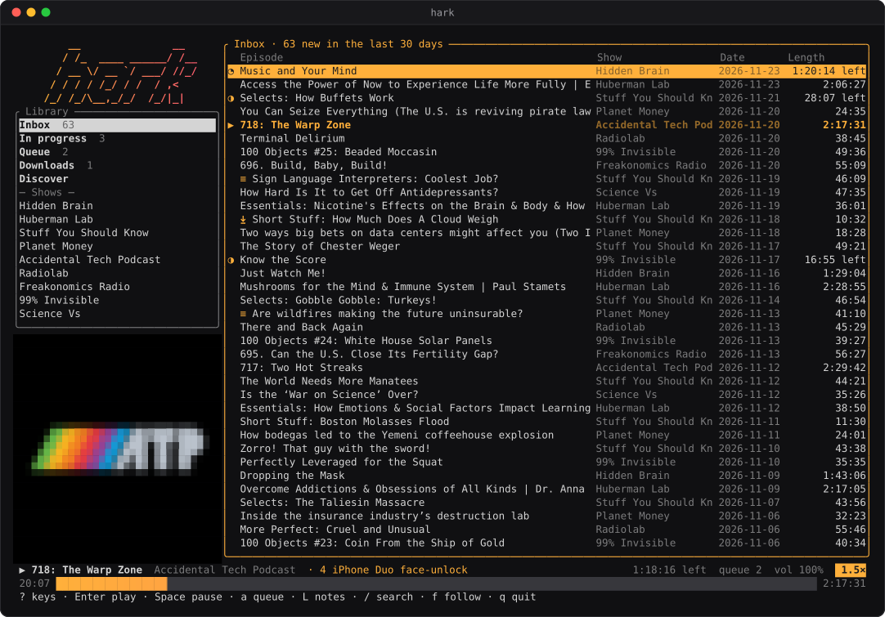
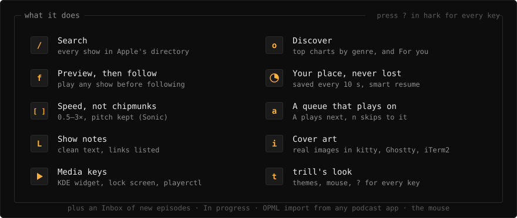
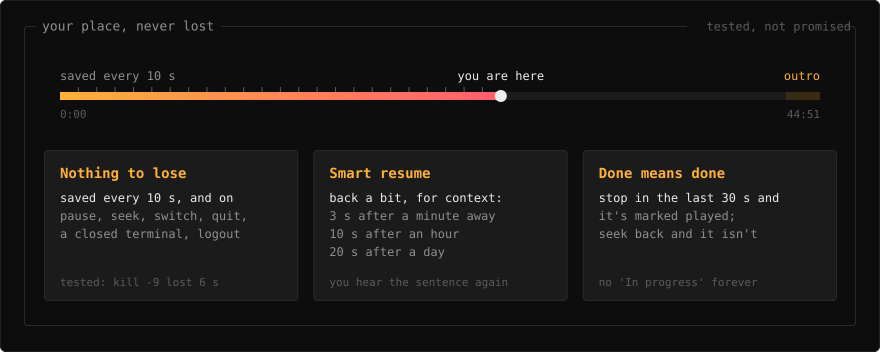
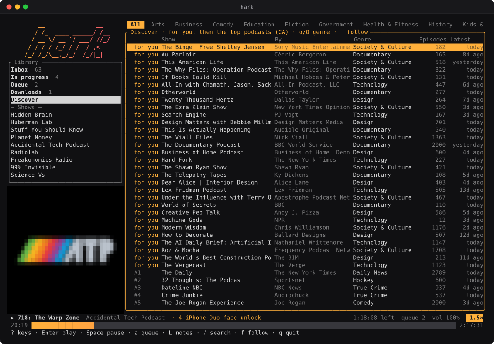
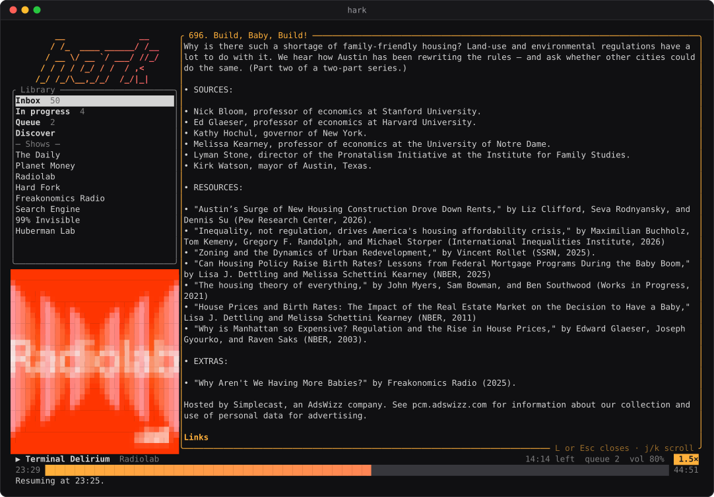

<p align="center">
  
</p>

<p align="center">
  <a href="https://github.com/junaydirfan/hark/releases/latest"></a>
  
  
  
  
  
  
</p>

<p align="center">
  
</p>

<p align="center">
  <a href="#install"><strong>Install</strong></a> (<a href="#linux">Linux</a> · <a href="#macos">macOS</a> · <a href="#windows">Windows</a>) &nbsp;·&nbsp;
  <a href="#features"><strong>Features</strong></a> &nbsp;·&nbsp;
  <a href="#your-place-never-lost"><strong>Your place</strong></a> &nbsp;·&nbsp;
  <a href="#numbers"><strong>Numbers</strong></a> &nbsp;·&nbsp;
  <a href="#keys"><strong>Keys</strong></a> &nbsp;·&nbsp;
  <a href="#faq"><strong>FAQ</strong></a>
</p>

hark is a podcast player for the terminal that does one thing and does it cheaply. It plays **every open podcast** (anything with a public feed, which is nearly all of them) straight from where the show hosts it. It **never loses your place**, and it **costs nothing while it waits**: the decoder, speed control and audio output all run inside one 4.7 MB program, with no mpv, no account and no analytics. It's built on the same principles, and in the same look, as [trill](https://github.com/junaydirfan/trill), a terminal Spotify player.

## Features

<p align="center">
  
</p>

<details>
<summary><strong>Every feature in a sentence</strong></summary>

- **Search** (`/`) every show in the Apple Podcasts directory, with its genre, its size and when its latest episode came out, so a dead show looks dead.
- **Discover:** *For you*, then the top charts for your country. `o` / `O` flips through 19 genres, from Business to True Crime.
- **Preview, then follow:** open any show, browse and play its episodes, and `f` to follow it when you like it.
- **Sort a show** (`s`): newest, oldest, longest or shortest first.
- **Inbox:** every unplayed episode from your shows in the last 30 days, newest first.
- **In progress:** what you started and didn't finish, most recent first, each with ◔ ◑ ◕ and the time left.
- **A queue that plays on:** `a` adds an episode, `A` plays it next, and when an episode ends the next one starts. It's kept between runs.
- **Speed without chipmunks:** 0.5–3×, with the pitch kept by [Sonic](https://github.com/waywardgeek/sonic), the algorithm made for speeding up speech. The now-playing line shows the time left *at your speed*.
- **Show notes:** `L` shows an episode's notes as clean text, with its links listed underneath.
- **Cover art** of what's playing, under the library: real images in kitty, Ghostty, WezTerm, foot, iTerm2 and Konsole, and colour half-blocks everywhere else.
- **Desktop native (Linux):** media keys, the KDE and GNOME media widgets, the lock screen, `playerctl` and KDE Connect, through MPRIS. Speed is the playback rate there, so the widget can change it too.
- **Bring your shows:** paste a feed URL, or the path to an OPML file exported from AntennaPod, Pocket Casts, Overcast, Apple Podcasts or any other app. Your shows are kept as OPML too, so you can take them anywhere.
- **trill's look:** the same layout, `?` for every key, colour themes on `t`, and the mouse (click to open, double-click to play, click the bar to seek, scroll the pane under the pointer).
</details>

## Your place, never lost

<p align="center">
  
</p>

This is the feature people who listen to a lot of podcasts care about most, so it was tested rather than assumed:

| What happened | What hark kept |
|---|---|
| The terminal window was closed at 5:11 | 5:11, to the second |
| `kill -9` at 5:27 (as bad as a crash gets) | 5:21, saved 6 s earlier |
| Reopened within a minute | exactly where it was |
| Reopened two hours later | 10 s earlier, so you hear the sentence again |
| Stopped at 32:18 of 32:34 | marked played (the outro doesn't count) |

hark also keeps the length the player actually measures. Feeds' own durations are often off, more so when ads are inserted on the fly, and "time left" uses the measured one.

## Find your next show

<p align="center">
  
</p>

*For you* is made from the categories your own feeds declare (`itunes:category`): hark fetches the charts for your top genres, takes them in turns, and leaves out what you already follow. **Your list of shows never leaves your machine;** see [Privacy](#privacy).

<p align="center">
  
</p>

## Numbers

<p align="center">
  
</p>

<details>
<summary><strong>Every measurement</strong></summary>

Measured on an i9-14900HX, memory as PSS.

| | |
|---|---|
| The whole app, idle, 8 shows (3,514 episodes) | 10.6 MB |
| Playing, with the cover drawn | 15–18 MB |
| The player alone, streaming an episode | 8.1 MB |
| mpv playing the same episode, scripts, config and caches stripped down | 61 MB |
| CPU while paused | 0 (no thread wakes up) |
| CPU while playing at 1.5×, screen included | ~1.3–2% of one core |
| Read a 20.7 MB feed (The Daily, 3,044 episodes) | 19 ms |
| Read a 2 MB feed | ~3 ms |
| From a link to playing (through the show's tracking redirects) | ~0.6 s |
| Start a stream at 22:00 (a range request) | ~0.6 s, ~20 ms buffering |
| Refresh a feed that hasn't changed | 0 bytes of body (HTTP 304) |
| The binary | 4.7 MB, nothing else to install |
</details>

## Install

| | Download | Runs on |
|---|---|---|
| **Linux** | [`hark-linux-x86_64.tar.gz`](https://github.com/junaydirfan/hark/releases/latest/download/hark-linux-x86_64.tar.gz) | x86_64 with glibc 2.39+: Ubuntu 24.04+, Debian 13+, Fedora 40+, Arch, CachyOS, Manjaro |
| **macOS** | [`hark-macos-arm64.tar.gz`](https://github.com/junaydirfan/hark/releases/latest/download/hark-macos-arm64.tar.gz) | Apple Silicon (M1 and later) |
| **Windows** | [`hark-windows-x86_64.zip`](https://github.com/junaydirfan/hark/releases/latest/download/hark-windows-x86_64.zip) | Windows 10 and 11, x64 |

Anything else (Intel Macs, ARM Linux, an older distro) can [build from source](#build-from-source) in a minute or two.
hark is developed and tested on Linux. The macOS and Windows builds are made and tested by CI on
every release, but have seen less real listening; if something's off there, please [open an issue](https://github.com/junaydirfan/hark/issues).

### Linux

```sh
curl -L https://github.com/junaydirfan/hark/releases/latest/download/hark-linux-x86_64.tar.gz | tar xz
mkdir -p ~/.local/bin && install -m 755 hark ~/.local/bin/ && rm hark
hark --version
```

If your shell says `hark: command not found`, `~/.local/bin` isn't on your `PATH` yet. Add it once and open a new terminal:

```sh
fish_add_path ~/.local/bin                                     # fish (CachyOS's default)
echo 'export PATH="$HOME/.local/bin:$PATH"' >> ~/.bashrc       # bash
echo 'export PATH="$HOME/.local/bin:$PATH"' >> ~/.zshrc        # zsh
```

It needs only what every Linux desktop already has: PipeWire or PulseAudio for sound, and the OpenSSL 3 and
ALSA libraries.
Media keys, the KDE and GNOME media widgets and the lock screen work out of the box.

### macOS

In Terminal (or Ghostty, iTerm2, kitty, WezTerm):

```sh
curl -L https://github.com/junaydirfan/hark/releases/latest/download/hark-macos-arm64.tar.gz | tar xz
sudo mkdir -p /usr/local/bin && sudo mv hark /usr/local/bin/
hark --version
```

hark isn't signed by Apple. Downloaded with `curl` as above, it just runs. If you downloaded it in a browser
instead and macOS says it *can't be opened because Apple cannot check it*, clear the download flag once:

```sh
xattr -d com.apple.quarantine /usr/local/bin/hark
```

Cover art shows as a real picture in Ghostty, iTerm2, kitty and WezTerm, and as colour blocks in Terminal.app.
Media keys and Control Center aren't wired up on macOS yet.

### Windows

In PowerShell (Windows Terminal is best; it comes with Windows 11):

```powershell
$dir = "$env:LOCALAPPDATA\Programs\hark"
Invoke-WebRequest https://github.com/junaydirfan/hark/releases/latest/download/hark-windows-x86_64.zip -OutFile "$env:TEMP\hark.zip"
Expand-Archive "$env:TEMP\hark.zip" -DestinationPath $dir -Force
# put hark on your PATH (once); new terminals pick it up
$path = [Environment]::GetEnvironmentVariable("Path", "User")
if ($path -notlike "*$dir*") { [Environment]::SetEnvironmentVariable("Path", "$path;$dir", "User") }
```

Open a **new** terminal and run `hark`. hark isn't signed by Microsoft, so if you downloaded the zip in a browser,
Windows may stop it with *Windows protected your PC*; choose **More info → Run anyway**, or run
`Unblock-File "$env:LOCALAPPDATA\Programs\hark\hark.exe"` once. Media keys aren't wired up on Windows yet.

### Updating and removing

To update, quit hark and run:

```sh
hark --update
```

It downloads the latest release for your system, checks that it runs, and puts it in place of the old `hark`; your shows, your place and your queue stay. hark also says on its bottom line when a new version is out. If it can't replace the file (say `/usr/local/bin` on macOS, which needs `sudo`), or you're on 0.1.2 or older (no `--update` yet), run the install commands again: they do the same.

To remove hark, delete the program and its two folders:

| | Program | Your shows, place, queue | Caches (safe to delete any time) |
|---|---|---|---|
| Linux | `~/.local/bin/hark` | `~/.local/share/hark` | `~/.cache/hark` |
| macOS | `/usr/local/bin/hark` | `~/Library/Application Support/hark` | `~/Library/Caches/hark` |
| Windows | `%LOCALAPPDATA%\Programs\hark` | `%APPDATA%\hark` | `%LOCALAPPDATA%\hark` |

### Build from source

You need [Rust](https://rustup.rs) 1.88 or newer. On Linux, also the ALSA and OpenSSL headers:
`sudo pacman -S alsa-lib openssl` (Arch, CachyOS), `sudo apt install libasound2-dev libssl-dev pkg-config`
(Debian, Ubuntu) or `sudo dnf install alsa-lib-devel openssl-devel` (Fedora).

```sh
git clone https://github.com/junaydirfan/hark && cd hark
cargo build --release
./target/release/hark          # or: cargo install --path .
```

## Get started

1. Press `/` and search for a show, or open **Discover** in the sidebar.
2. `Enter` opens a show, `Enter` again plays an episode, and `f` follows the show.
3. Already have a podcast app? Export its OPML file, press `/`, and paste the file's path: all your shows come over at once.

From then on, new episodes land in the **Inbox**, and whatever you start waits in **In progress**.

## Keys

<p align="center">
  
</p>

<details>
<summary><strong>Keys as text</strong></summary>

| key | action | | key | action |
|---|---|---|---|---|
| `↑↓` `jk` `PgUp/PgDn` `g/G` | move | | `Space` | play / pause |
| `Tab` `h` `l` | switch pane | | `←` `,` / `→` `.` | back 15 s / forward 30 s |
| `Enter` | open / play | | `p` | back to the start |
| `Esc` | back | | `[` / `]` | speed −/+ 0.1× |
| `w` | jump to the playing episode | | `+` / `-` | volume ±5% |
| `a` / `A` | queue / play next | | `n` | next in the queue |
| `m` | mark played / unplayed | | `L` | show notes |
| `/` | search · paste a feed URL / OPML | | `R` | refresh every show now |
| `f` | follow the highlighted show | | `o` / `O` | Discover: next / previous genre |
| `D` `D` | unsubscribe | | `t` / `i` | next colour theme / cover on-off |
| `q` `Ctrl-C` | quit (your place is saved) | | `?` | every key |

In lists: `▶` playing, `◔ ◑ ◕` started (with the time left), `✓` played, `≡` queued, `[E]` explicit.
</details>

## How it works

<p align="center">
  
</p>

<details>
<summary><strong>Why it's light</strong></summary>

- **One async thread** draws the screen and does the networking. Input waits on its own thread and audio on another, each asleep until there's something to do. The screen redraws only when something changes.
- **Audio is decoded inside hark** ([symphonia](https://github.com/pdeljanov/Symphonia)), sped up by [Sonic](https://github.com/waywardgeek/sonic) and played through [cpal](https://github.com/RustAudio/cpal). No mpv: that alone saves about 50 MB.
- **Pausing closes the audio output**, so nothing wakes up while you're paused, not even the sound server's client thread.
- **Streams play while they download** into `~/.cache/hark/tmp`. A seek past what has arrived restarts the download there with a range request, and a slow network shows as "buffering" instead of freezing the keys.
- **Feeds are read in one streaming pass**, keeping only what hark shows, and refreshed "only if changed". Most servers then send nothing at all, and for the ones that ignore that, an unchanged ETag skips the work.
- **Show notes stay on disk**, one file per show, and are read one episode at a time when you open them. Together they're most of a feed's size (6 MB for The Daily).
- **Only the rows that fit are drawn**, so a 3,000-episode show scrolls as fast as a short one.
- **Big downloads don't leave their memory behind:** freed memory goes back to the OS, big buffers never land in the heap, and parsed feeds are copied off the parser's thread so its memory can be returned whole.
- **Cover art** is shrunk before encoding (podcast covers can be 3000 px), and the download isn't kept.
</details>

## Privacy

hark has no account and sends no analytics. It talks to the servers of the shows you follow (for their feeds and audio), to Apple's public podcast directory only for Discover and search, and to GitHub for updates:

- **Search** sends what you type.
- **Charts** send a genre and your country, taken from your locale (e.g. `en_CA` → Canada).
- **Updates:** once a day hark asks GitHub for the number of the latest release. Nothing about you or your shows is sent.
- ***For you*** is built from the categories your own feeds declare. hark fetches the charts for those genres and leaves out what you follow, so **your list of shows never leaves your machine**.

## Where things live

| | |
|---|---|
| `~/.local/share/hark/subscriptions.opml` | your shows, as standard OPML |
| `~/.local/share/hark/state.tsv` | where you are in each episode you've started, and what you've finished |
| `~/.local/share/hark/queue.tsv` | the queue |
| `~/.local/share/hark/prefs` | speed, volume, theme, cover on/off |
| `~/.cache/hark/` | feed caches, show notes, the episode streaming right now, and the latest release seen; safe to delete |

On macOS these live under `~/Library/Application Support/hark` and `~/Library/Caches/hark`, and on Windows under `%APPDATA%\hark` and `%LOCALAPPDATA%\hark`. Every file is written to a temporary file first and then renamed into place, so a crash never leaves half a file behind.

## FAQ

**Can it play Spotify podcasts?**
Not the Spotify exclusives. Spotify refuses podcast audio and details to third-party players (it answers HTTP 451). Most shows on Spotify also publish a public feed, though, and hark plays those: search for the show in hark.

**Does my place sync with my phone?**
Not yet. Sync through the gPodder protocol (gpodder.net or Nextcloud, which AntennaPod speaks) is next on the [plan](PLAN.md).

**Video podcasts?**
hark plays their audio.

**Why not just use mpv?**
It's a great player, but it used about 61 MB to play an episode that hark's own player plays in 8. hark is meant to stay running all day without being noticed.

**Where does the name come from?**
*Hark*: an old word for "listen".

## Development

```sh
cargo test                                       # feed parsing, dates, OPML, progress rules, layout
hark feed <url|file>                             # fetch and parse one feed, with timings
hark play <url|file> [speed] [start_s] [volume]  # the audio engine on its own: seek, pause, resume, memory, CPU
```

The graphics in this README are generated by [`assets/readme/make.py`](assets/readme/make.py) (see its header). The screenshots are real: `tmux` captures of hark itself, rendered cell by cell. They use [JetBrains Mono](https://github.com/JetBrains/JetBrainsMono) (SIL OFL 1.1), embedded as a renamed subset.

hark stands on [ratatui](https://ratatui.rs), [symphonia](https://github.com/pdeljanov/Symphonia), [Sonic](https://github.com/waywardgeek/sonic) (via `libsonic`), [cpal](https://github.com/RustAudio/cpal), [quick-xml](https://github.com/tafia/quick-xml) and [mpris-server](https://github.com/SeaDve/mpris-server).
